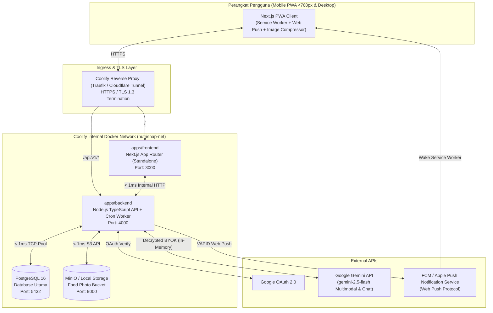
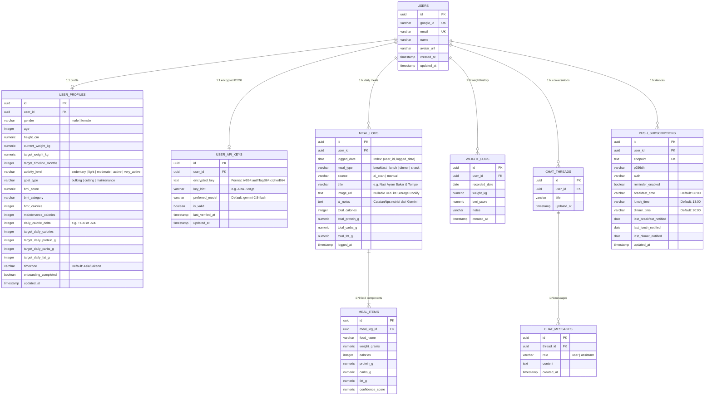
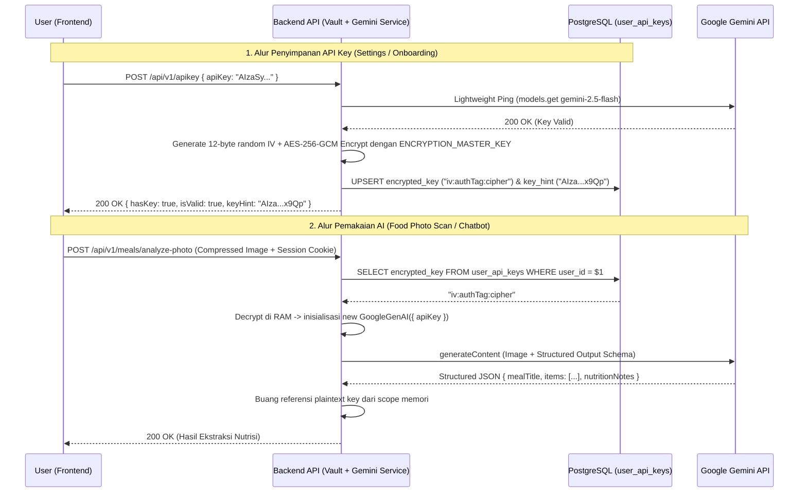

# System Architecture & Infrastructure Blueprint (ARCHITECTURE.md) — NutriSnap

> **Architectural Pattern:** Modular TypeScript Monorepo (`apps/frontend`, `apps/backend`, `packages/shared`)  
> **Deployment Model:** Self-Hosted Single-Node / Docker Network on **Coolify**  
> **Database & Storage:** PostgreSQL 16 + S3-Compatible Storage (MinIO / Local Volume)

---

## 1. High-Level System Topology (Full Coolify Deployment)

Dengan menempatkan seluruh stack di dalam satu server **Coolify**, komunikasi antar-container (`frontend` <-> `backend` <-> `postgres` <-> `storage`) berjalan di atas jaringan bridge Docker internal dengan *network latency* `< 1ms`, tanpa biaya bandwidth cloud eksternal dan tanpa batas payload serverless 4.5MB.



---

## 2. Monorepo Directory Structure

```text
nutrisnap/
├── AGENTS.md                        # Panduan utama AI Agents & Konvensi Kode
├── docs/                            # Dokumentasi Produk, Desain, Arsitektur, & Agile
│   ├── PRD.md
│   ├── DESIGN.md
│   ├── ARCHITECTURE.md
│   ├── API_CONTRACT.md
│   ├── SPRINT.md
│   └── PROGRESS_TRACKER.md
├── apps/
│   ├── frontend/                    # Next.js 15+ (App Router), Tailwind CSS, Shadcn UI, PWA
│   │   ├── public/
│   │   │   ├── icons/               # PWA App Icons (192, 512, maskable)
│   │   │   └── sw.js                # Service Worker untuk Web Push & Caching
│   │   ├── src/
│   │   │   ├── app/
│   │   │   │   ├── (auth)/login/
│   │   │   │   ├── (onboarding)/onboarding/
│   │   │   │   ├── (app)/
│   │   │   │   │   ├── layout.tsx   # Responsive Shell (BottomNav <768px & Sidebar >=768px)
│   │   │   │   │   ├── dashboard/
│   │   │   │   │   ├── log/
│   │   │   │   │   ├── chat/
│   │   │   │   │   ├── analytics/
│   │   │   │   │   └── settings/
│   │   │   │   └── manifest.ts
│   │   │   ├── components/
│   │   │   │   ├── ui/              # Shadcn UI Primitives
│   │   │   │   ├── layout/          # BottomNav, DesktopSidebar, ThemeToggle
│   │   │   │   ├── nutrition/       # CalorieRing, SurplusBadge, AiFoodScanner, ManualFoodForm
│   │   │   │   ├── chat/            # DietChatbot
│   │   │   │   └── pwa/             # InstallPrompt, PushNotificationManager
│   │   │   └── lib/
│   │   │       ├── api-client.ts    # Typed HTTP Client ke apps/backend
│   │   │       └── image-compress.ts# Client-side Canvas WebP/JPEG Resizer (<=1280px)
│   │   ├── Dockerfile
│   │   └── package.json
│   └── backend/                     # Node.js TypeScript Backend API + Scheduler
│       ├── src/
│       │   ├── config/
│       │   │   └── env.ts           # Validasi Zod untuk seluruh Environment Variables
│       │   ├── crypto/
│       │   │   └── vault.ts         # AES-256-GCM Encryption & Decryption untuk BYOK
│       │   ├── db/
│       │   │   ├── index.ts         # Koneksi PostgreSQL Pool + Drizzle ORM
│       │   │   ├── schema.ts        # Definisi Tabel & Relasi Database
│       │   │   └── seed-foods.ts    # Data awal makanan populer Indonesia & umum (per 100g)
│       │   ├── middlewares/
│       │   │   ├── auth.middleware.ts
│       │   │   └── error.middleware.ts
│       │   ├── modules/
│       │   │   ├── auth/            # Google OAuth 2.0 Verification & JWT/Session Cookie
│       │   │   ├── profile/         # Onboarding, BMI/BMR/TDEE Calculation, Weight History
│       │   │   ├── apikey/          # Simpan, Validasi, & Hapus BYOK Gemini Key
│       │   │   ├── meals/           # AI Photo Scan, Manual Gram Input, & Daily Summary
│       │   │   ├── chat/            # Contextual Bulking/Diet Chatbot via Gemini
│       │   │   └── notifications/   # VAPID Push Subscription & Cron Meal Reminder
│       │   ├── jobs/
│       │   │   └── meal-reminder.job.ts # Cron setiap 15 menit untuk cek makan belum di-log
│       │   └── index.ts
│       ├── Dockerfile
│       └── package.json
├── packages/
│   └── shared/                      # Shared TypeScript Package (@nutrisnap/shared)
│       ├── src/
│       │   ├── nutrition.ts         # Rumus BMI, BMR, TDEE, Surplus/Deficit, Macro Targets
│       │   ├── schemas.ts           # Skema Validasi Zod untuk Request & Response API
│       │   └── index.ts
│       └── package.json
├── docker-compose.coolify.yml       # Production Stack untuk Coolify
├── pnpm-workspace.yaml
└── package.json
```

---

## 3. Database Schema (PostgreSQL + Drizzle ORM)



### Database Indexing Strategy
Untuk menjamin query `< 10ms`:
1. `idx_meal_logs_user_date` pada `meal_logs (user_id, logged_date)` — Mempercepat pengambilan ringkasan kalori/protein harian di Dashboard dan pengecekan *cron job* pengingat makan.
2. `idx_weight_logs_user_date` pada `weight_logs (user_id, recorded_date DESC)` — Mempercepat grafik progres berat badan di halaman Analytics.
3. `idx_chat_messages_thread` pada `chat_messages (thread_id, created_at ASC)` — Mempercepat pemuatan riwayat percakapan AI Coach.

---

## 4. Security Architecture: BYOK AES-256-GCM Encryption Vault



---

## 5. Multimodal Image Pipeline & Performance Optimization

Untuk mencegah *bottleneck* upload foto kamera smartphone yang besar (5–12 MB):
1. **Tahap 1 — Client-Side Compression (`apps/frontend/src/lib/image-compress.ts`):**
   - Saat user memilih foto dari kamera/galeri, browser menggambar ulang foto ke HTML5 `<canvas>` dengan dimensi sisi terpanjang maksimal **1280px** dan mengekspornya ke `image/webp` (atau `image/jpeg` dengan `quality: 0.82`).
   - Ukuran payload turun **> 95%** (dari ~8 MB menjadi **~150 KB**).
2. **Tahap 2 — Gemini Multimodal Structured Extraction (`apps/backend`):**
   - Backend menerima buffer gambar ~150 KB, mendekripsi API Key user, dan memanggil `ai.models.generateContent` pada model `gemini-2.5-flash` dengan `responseMimeType: "application/json"` dan `responseSchema` ketat.
3. **Tahap 3 — User Review & Storage Commit:**
   - Hasil analisis ditampilkan di UI agar user bisa memverifikasi/mengoreksi gramasi sebelum disimpan ke tabel `meal_logs` dan `meal_items`.

---

## 6. Scheduled Web Push Notification Engine (`meal-reminder.job.ts`)

1. **Pendaftaran Perangkat:**
   - Saat user mengaktifkan pengingat makan di `/settings`, Service Worker (`sw.js`) memanggil `pushManager.subscribe({ userVisibleOnly: true, applicationServerKey: VAPID_PUBLIC_KEY })`.
   - Objek subscription (`endpoint`, `keys.p256dh`, `keys.auth`) beserta jam pengingat (`breakfast_time`, `lunch_time`, `dinner_time`) dikirim ke `POST /api/v1/notifications/subscribe`.
2. **Eksekusi Cron Scheduler di Backend:**
   - Worker internal di `apps/backend` berjalan setiap **15 menit** (`*/15 * * * *`).
   - Untuk setiap subscription aktif (`reminder_enabled = true`):
     1. Hitung waktu dan tanggal lokal pengguna saat ini berdasarkan kolom `timezone` di `user_profiles` (contoh: `Asia/Jakarta`).
     2. Periksa apakah waktu lokal berada dalam rentang `[jam_makan, jam_makan + 45 menit]` dan belum pernah dikirimi notifikasi untuk sesi makan tersebut pada hari ini (`last_<meal>_notified != today`).
     3. Query tabel `meal_logs`: Apakah user sudah mencatat makanan dengan `meal_type` tersebut pada `logged_date = today`?
     4. Jika **belum ada log**, kirimkan Web Push Notification via protokol VAPID:
        - **Judul:** `"Waktunya Makan Siang, Raka! 🍛"`
        - **Isi:** `"Kamu belum mencatat makan siang hari ini. Yuk foto piringmu atau catat manual agar target +400 kcal tercapai!"`
        - **Action URL:** `/log?type=lunch`
     5. Jika endpoint mengembalikan HTTP `410 Gone` (user mencabut izin di browser), hapus subscription tersebut secara otomatis dari database.

