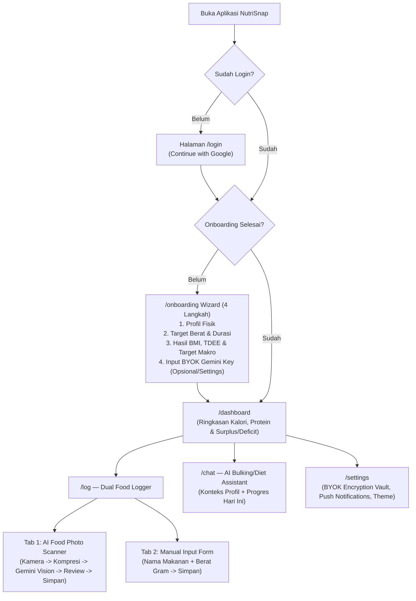

# UI/UX & Design System Specification (DESIGN.md) — NutriSnap

> **Design Philosophy:** *"Zero-Friction Nutritional Clarity"* — Menggabungkan estetika aplikasi kebugaran modern (bersih, kontras tinggi, penuh umpan balik visual mikro) dengan kecepatan input satu tangan pada perangkat mobile.

---

## 1. Brand Identity & Design Principles

- **Nama Brand:** **NutriSnap**
- **Tagline:** *Snap Your Plate. Hit Your Macros.*
- **Karakter Visual:** Energetik, Presisi, Modern, Bersih, Tanpa Friksi.
- **4 Prinsip Utama Design System:**
  1. **Thumb-First Ergonomics:** Seluruh aksi primer pada layar `< 768px` wajib berada dalam jangkauan ibu jari bawah dengan ukuran area sentuh (*touch target*) minimal `44x44px`.
  2. **Glanceable Data Hierarchy:** Pengguna harus langsung memahami sisa kalori, progres protein, dan status *Surplus/Deficit* dalam `< 1.5 detik` sejak membuka Dashboard.
  3. **Tabular Numeric Stability:** Semua angka kalori, gramasi makro, berat badan, dan persentase wajib menggunakan `font-variant-numeric: tabular-nums` agar layout tidak bergeser saat angka berubah.
  4. **Seamless Dual-Theme Parity:** Setiap komponen dirancang simultan untuk **Light Mode** (segar & terang di siang hari) dan **Dark Mode** (nyaman di mata saat mencatat makan malam).

---

## 2. Design System Foundations (Design Tokens)

### 2.1. Color Palette & Shadcn CSS Variables (`globals.css`)

NutriSnap menggunakan sistem token warna berbasis HSL/Hex yang kompatibel penuh dengan **Tailwind CSS** dan **Shadcn UI**.

#### A. Surface, Text, & Brand Tokens
| Token Name | CSS Variable | Light Mode (Hex / HSL) | Dark Mode (Hex / HSL) | Fungsi Penggunaan |
| :--- | :--- | :--- | :--- | :--- |
| **Background** | `--background` | `#F8FAFC` (`210 40% 98%`) | `#090D16` (`222 42% 6%`) | Canvas utama aplikasi |
| **Foreground** | `--foreground` | `#0F172A` (`222 47% 11%`) | `#F8FAFC` (`210 40% 98%`) | Teks judul & isi utama |
| **Card Surface** | `--card` | `#FFFFFF` (`0 0% 100%`) | `#111827` (`221 39% 11%`) | Kartu ringkasan, item log makanan, modal |
| **Card Foreground**| `--card-foreground` | `#0F172A` (`222 47% 11%`) | `#F8FAFC` (`210 40% 98%`) | Teks di dalam permukaan kartu |
| **Popover / Sheet**| `--popover` | `#FFFFFF` (`0 0% 100%`) | `#131C2E` (`220 41% 13%`) | Bottom sheet scanner, dropdown, tooltip |
| **Primary (Brand)**| `--primary` | `#10B981` (`160 84% 39%`) | `#10B981` (`160 84% 39%`) | Tombol utama, FAB Scan, progres aktif |
| **Primary Text** | `--primary-foreground`| `#FFFFFF` (`0 0% 100%`) | `#042F2E` (`179 84% 10%`) | Teks/ikon di atas warna `--primary` |
| **Secondary** | `--secondary` | `#F1F5F9` (`210 40% 96%`) | `#1E293B` (`217 33% 17%`) | Tombol sekunder, chip filter, tab inaktif |
| **Muted Surface** | `--muted` | `#F1F5F9` (`210 40% 96%`) | `#1E293B` (`217 33% 17%`) | Skeleton loader, track progress bar kosong |
| **Muted Text** | `--muted-foreground` | `#64748B` (`215 16% 47%`) | `#94A3B8` (`215 20% 65%`) | Label sekunder, satuan (`kcal`, `g`, `kg`) |
| **Accent** | `--accent` | `#ECFDF5` (`152 81% 96%`) | `#064E3B` (`163 88% 16%`) | Hover state, highlight item terpilih |
| **Destructive** | `--destructive` | `#EF4444` (`0 84% 60%`) | `#F87171` (`0 91% 71%`) | Hapus log makanan, error validasi, over-limit |
| **Border & Input** | `--border` / `--input`| `#E2E8F0` (`214 32% 91%`) | `#1E293B` (`217 33% 17%`) | Garis batas kartu `1px`, outline form input |
| **Focus Ring** | `--ring` | `#10B981` (`160 84% 39%`) | `#34D399` (`158 64% 52%`) | Outline aksesibilitas keyboard (`ring-2`) |

#### B. Nutrition & Program Semantic Tokens
| Token | CSS Variable | Light / Dark Hex | Tailwind Utility | Penggunaan Spesifik |
| :--- | :--- | :--- | :--- | :--- |
| **Calorie Energy** | `--macro-calories` | `#10B981` | `text-emerald-500` / `bg-emerald-500` | Lingkaran utama kalori harian (`kcal`) |
| **Protein Muscle** | `--macro-protein` | `#6366F1` | `text-indigo-500` / `bg-indigo-500` | Progress bar & badge Protein (`g`) |
| **Carbs Fuel** | `--macro-carbs` | `#F59E0B` | `text-amber-500` / `bg-amber-500` | Progress bar & badge Karbohidrat (`g`) |
| **Fat Essential** | `--macro-fat` | `#F43F5E` | `text-rose-500` / `bg-rose-500` | Progress bar & badge Lemak (`g`) |
| **Bulking Surplus**| `--status-surplus` | `#06B6D4` | `text-cyan-500` / `bg-cyan-500/15` | Badge status *In Surplus Zone* (`+kcal`) |
| **Cutting Deficit**| `--status-deficit` | `#8B5CF6` | `text-violet-500` / `bg-violet-500/15` | Badge status *On-Track Deficit* (`-kcal`) |
| **Maintenance** | `--status-maintain`| `#3B82F6` | `text-blue-500` / `bg-blue-500/15` | Badge status *Maintenance Zone* |

---

### 2.2. Typography System & Type Scale

- **Font Family Sans (`--font-sans`):** `'Plus Jakarta Sans', 'Inter', system-ui, sans-serif`
- **Font Family Mono (`--font-mono`):** `'JetBrains Mono', monospace` (khusus angka metrik nutrisi & API Key hint)

| Token / Level | Ukuran (`rem` / `px`) | Line Height | Font Weight | Tailwind Class | Penggunaan |
| :--- | :--- | :--- | :--- | :--- | :--- |
| **Display Metric** | `2.25rem` (`36px`) | `2.5rem` (`40px`) | `800` (ExtraBold) | `text-4xl font-extrabold tabular-nums tracking-tight` | Angka utama kalori tersisa di tengah Calorie Ring |
| **H1 (Page Title)**| `1.5rem` (`24px`) | `2rem` (`32px`) | `700` (Bold) | `text-2xl font-bold tracking-tight` | Judul halaman utama (`Dashboard`, `AI Diet Coach`) |
| **H2 (Section)** | `1.125rem` (`18px`) | `1.75rem` (`28px`)| `600` (SemiBold) | `text-lg font-semibold` | Judul seksi waktu makan (`Makan Siang`, `Target Makro`) |
| **H3 (Card Title)**| `1rem` (`16px`) | `1.5rem` (`24px`) | `600` (SemiBold) | `text-base font-semibold` | Nama hidangan/makanan pada kartu log |
| **Body Default** | `0.875rem` (`14px`) | `1.25rem` (`20px`)| `400` (Regular) | `text-sm` | Teks deskripsi umum, bubble chat AI, input form |
| **Body Medium** | `0.875rem` (`14px`) | `1.25rem` (`20px`)| `500` (Medium) | `text-sm font-medium` | Label form, tombol, item navigasi |
| **Caption / Micro**| `0.75rem` (`12px`) | `1rem` (`16px`) | `500` (Medium) | `text-xs text-muted-foreground` | Satuan gramasi, timestamp, label bawah ikon navbar |

---

### 2.3. Spacing, Grid, Border Radius, & Elevation

1. **Base Spacing Unit:** Sistem grid `4px` (`0.25rem`).
   - Padding halaman mobile (`< 768px`): `px-4 py-4 pb-24` (`pb-24` wajib agar konten paling bawah tidak tertutup Bottom Navbar `h-16`).
   - Padding halaman desktop (`>= 768px`): `px-8 py-6`.
   - Jarak antar kartu (*Card Gap*): `gap-4` (`16px`) pada mobile, `gap-6` (`24px`) pada desktop.
2. **Border Radius Scale (`--radius: 0.875rem` / `14px`):**
   - **Card & Modal:** `rounded-2xl` (`16px`) — Memberikan kesan organik dan ramah pada aplikasi mobile/PWA.
   - **Buttons & Inputs:** `rounded-xl` (`12px`).
   - **Badges & Quick Chips:** `rounded-full` (`9999px`).
3. **Elevation & Glassmorphism:**
   - **Card Shadow (Light):** `shadow-sm shadow-slate-200/60 border border-border/80`.
   - **Card Shadow (Dark):** `shadow-none border border-slate-800/90 bg-card/90`.
   - **Floating Action Button (Scan):** `shadow-lg shadow-emerald-500/30 hover:shadow-emerald-500/45`.
   - **Sticky Header & Bottom Navbar:** `bg-background/80 backdrop-blur-xl supports-[backdrop-filter]:bg-background/65`.

---

### 2.4. Motion & Micro-Interactions

- **Progress Ring & Bar Fill:** `transition-all duration-700 cubic-bezier(0.22, 1, 0.36, 1)` saat nilai kalori/protein bertambah.
- **Button Tap Feedback (Mobile PWA):** `active:scale-[0.97] transition-transform duration-100` pada seluruh tombol interaktif agar terasa seperti aplikasi *native* iOS/Android.
- **AI Photo Scanner Laser Effect:** Animasi garis hijau emerald (`animate-pulse` + keyframe translasi vertikal) di atas pratinjau foto saat menunggu hasil ekstraksi Gemini Multimodal.

---

## 3. Component Design System Library (`apps/frontend/src/components`)

Berikut adalah standar komponen UI yang digunakan di seluruh aplikasi:

### 3.1. Base Primitives (`components/ui/` — Shadcn UI Customized)

| Komponen | Variants Utama | Aturan Ukuran & Aksesibilitas |
| :--- | :--- | :--- |
| **`Button`** | `default` (Emerald Primary), `secondary`, `outline`, `ghost`, `destructive` | Tinggi default `h-11` (`44px`) di mobile agar ramah sentuhan; mendukung prop `isLoading` dengan spinner `Loader2`. |
| **`Input` & `NumberInput`** | `default`, `withSuffix` (`kg`, `cm`, `gram`, `kcal`) | Tinggi `h-11`, font size minimal `16px` (`text-base`) di mobile untuk **mencegah auto-zoom paksa pada Safari iOS** saat mengetik. |
| **`Card`** | `default`, `interactive` (hover border primary), `glass` | Menggunakan `rounded-2xl`, `p-4` (mobile) atau `p-6` (desktop). |
| **`Badge`** | `surplus`, `deficit`, `maintenance`, `macro`, `outline` | `rounded-full px-2.5 py-0.5 text-xs font-semibold`. |
| **`Tabs`** | `segmented` (Pill switcher untuk AI Scan vs Manual Input) | Lebar penuh (`grid-cols-2`) di halaman `/log` dengan transisi indikator aktif. |
| **`Progress`** | `calorie`, `protein`, `carbs`, `fat` | Mendukung warna indikator dinamis berdasarkan jenis makronutrisi. |
| **`Drawer` / `Dialog`** | Responsive Sheet (`Drawer` di `<768px`, `Dialog` di `>=768px`) | Digunakan untuk konfirmasi edit item makanan dan detail nutrisi. |

### 3.2. Domain-Specific Nutrition Components (`components/nutrition/`)

1. **`CalorieMacroHeroCard`**:
   - Menampilkan **SVG Circular Progress Ring** di sisi kiri/tengah (Kalori Masuk vs Target Kalori Harian, serta penanda garis *Maintenance Calories/TDEE*).
   - Menampilkan **Surplus/Deficit Status Pill** (contoh: `🔥 Bulking Zone: +385 kcal di atas TDEE` atau `⚡ Sisa 620 kcal menuju target Surplus`).
   - Menampilkan 3 **Macro Mini-Bars** di bawahnya: **Protein** (`indigo-500`), **Karbohidrat** (`amber-500`), dan **Lemak** (`rose-500`) lengkap dengan satuan `gram` saat ini vs target.
2. **`AiFoodScannerCard`**:
   - **State 1 (Idle):** Tombol kamera besar (`Ambil Foto Makanan`) + tombol sekunder (`Pilih dari Galeri`) + input opsional catatan singkat (*"Misal: dada ayam tanpa kulit"*).
   - **State 2 (Compressing & Scanning):** Menampilkan thumbnail foto yang telah dikompresi (`<=1280px`) dengan overlay animasi pemindaian AI dan teks status bertahap (*"Mengoptimalkan foto..."* -> *"Gemini sedang menghitung kalori & protein..."*).
   - **State 3 (Editable Confirmation List):** Menampilkan daftar item hasil deteksi AI. Setiap baris memiliki input cepat untuk mengubah **Berat (gram)** (yang otomatis menskalakan ulang kalori & protein secara proporsional), tombol tambah item manual, serta tombol utama **"Simpan ke Log Harian"**.
3. **`ManualFoodLoggerForm`**:
   - Selector waktu makan (`Sarapan`, `Makan Siang`, `Makan Malam`, `Camilan`).
   - Autocomplete chip makanan populer lokal (*Nasi Putih, Dada Ayam, Telur Rebus, Tempe, Tahu, Pisang, Susu Whey, dll.*) + input bebas **Nama Makanan** dan **Berat (`gram`)**.
   - Tombol **"⚡ Hitung Kalori & Protein Otomatis"** (menggunakan referensi lokal atau estimasi Gemini) dan input angka Kalori/Protein yang tetap bisa diedit manual.

---

## 4. Responsive Layout Architecture (`< 768px` vs `>= 768px`)

### 4.1. Mobile & PWA Viewport (`< 768px` — `md:hidden`)
Dirancang untuk penggunaan satu tangan (*thumb-zone friendly*):

```text
+---------------------------------------+
| [Logo] NutriSnap       [Theme] [Key]  |  <- Sticky Top Header (h-14, backdrop-blur)
+---------------------------------------+
|                                       |
|   +-------------------------------+   |
|   |   CALORIE & SURPLUS RING      |   |  <- Main Hero Card (rounded-2xl)
|   |     1,850 / 2,650 kcal        |   |
|   |  [Badge: Bulking +400 kcal]   |   |
|   |  Protein: [========--] 118/140g|   |
|   +-------------------------------+   |
|                                       |
|   Quick Meal Sections:                |
|   +-------------------------------+   |
|   | Sarapan (520 kcal • 28g P) [+] |   |
|   | - Nasi + 2 Telur Dadar (260g) |   |
|   +-------------------------------+   |
|   | Makan Siang (780 kcal•52g P)[+]|   |
|   | - Ayam Bakar + Tempe (350g)   |   |
|   +-------------------------------+   |
|                                       |
+---------------------------------------+
|  [Home]  [Stats]  (( + )) [Chat] [Set]|  <- Fixed Bottom Navbar (<768px)
|                   Scan/Log            |     dengan Floating Center Action Button
+---------------------------------------+
```

**Spesifikasi Teknis Bottom Navbar (`< 768px`):**
- Posisi: `fixed bottom-0 inset-x-0 z-50 h-16 md:hidden`.
- Padding iOS Safe Area: `pb-[env(safe-area-inset-bottom)]`.
- Efek Glassmorphism: `bg-background/85 backdrop-blur-lg border-t border-border`.
- **5 Item Navigasi:**
  1. **Home (`/dashboard`)**: Ikon `LayoutDashboard` — Ringkasan harian.
  2. **Progress (`/analytics`)**: Ikon `TrendingUp` — Grafik berat badan, BMI, & histori kalori.
  3. **+ Scan / Log (`/log`)**: Tombol tengah menonjol (`-mt-6 h-14 w-14 rounded-full bg-primary text-primary-foreground shadow-lg shadow-primary/30`) — Membuka AI Camera Scanner & Manual Form.
  4. **AI Coach (`/chat`)**: Ikon `BotMessageSquare` — Chatbot konsultasi bulking/diet.
  5. **Settings (`/settings`)**: Ikon `Settings` — BYOK Gemini API Key, Target Tubuh, & Push Notification.

### 4.2. Tablet & Desktop Viewport (`>= 768px` — `hidden md:flex`)
Pada layar tablet dan desktop, Bottom Navbar disembunyikan dan digantikan oleh **Left Navigation Sidebar (`w-64`)** serta tata letak konten **Bento Grid 12-Kolom**:

```text
+------------------+----------------------------------------------------+
| [Logo] NutriSnap |  Selamat Malam, Raka!          [+ Scan / Log Meal] |
|                  +----------------------------------------------------+
| - Dashboard      |  +------------------------+  +-------------------+ |
| - Scan & Log     |  | CALORIE & MACRO RING   |  | SURPLUS TRACKER   | |
| - AI Diet Coach  |  | 1,850 / 2,650 kcal     |  | TDEE: 2,250 kcal  | |
| - Analytics      |  | Protein: 118g / 140g   |  | Target: +400 kcal | |
| - Settings       |  +------------------------+  +-------------------+ |
|                  |  +-----------------------------------------------+ |
| [BYOK: Active]   |  | TODAY'S MEAL TIMELINE (Breakfast/Lunch/Dinner)| |
| [Dark/Light]     |  | ...                                           | |
| [User Profile]   |  +-----------------------------------------------+ |
+------------------+----------------------------------------------------+
```

---

## 5. User Flows & Key Screen Specifications



### 5.1. Onboarding Personalization Wizard (`/onboarding`)
Dirancang sebagai *Multi-Step Interactive Card* dengan indikator progres 4 langkah:
1. **Step 1 — Data Fisik Dasar:** Nama panggilan, Gender (Pria/Wanita), Usia (tahun), Tinggi Badan (cm), Berat Badan Saat Ini (kg), dan Tingkat Aktivitas Harian.
2. **Step 2 — Tujuan & Timeline:** Target Berat Badan (kg) dan Target Durasi Waktu (slider/input dalam **Bulan** atau **Tahun**). Sistem otomatis mendeteksi apakah user sedang **Bulking (Surplus)**, **Cutting (Deficit)**, atau **Maintenance**.
3. **Step 3 — Blueprint Nutrisi Anda (Instant Preview):**
   - Menampilkan kartu hasil perhitungan: **Skor BMI**, **Maintenance Calories (TDEE)**, **Target Kalori Harian** (beserta angka surplus/defisit per hari, mis. `+420 kcal/hari`), dan **Target Protein Harian (`gram/hari`)**.
   - Jika target waktu terlalu ekstrem, muncul *Health Guardrail Banner* yang menyarankan penyesuaian durasi yang lebih sehat.
4. **Step 4 — Koneksi AI (BYOK Gemini API Key):**
   - Input field bermasker (`type="password"`) dengan tautan panduan cepat mendapatkan API Key gratis di *Google AI Studio*.
   - Tombol **"Test & Enkripsi Key"** yang memvalidasi key secara langsung sebelum masuk ke Dashboard.

### 5.2. AI Bulking & Diet Assistant (`/chat`)
- **Context Header Bar:** Menampilkan chip ringkas di bagian atas chat: `Mode: Bulking (+400 kcal) • Sisa Hari Ini: 750 kcal | 32g Protein`.
- **Quick Starter Prompts:**
  - *"Rekomendasi menu malam ini untuk menutup sisa protein saya"*
  - *"Ide camilan tinggi kalori murah untuk bulking"*
  - *"Apakah progres kalori saya hari ini sudah pas?"*
- **Message Bubbles:** Mendukung perenderan tabel nutrisi Markdown, daftar belanja/resep singkat, dan indikator *typing/streaming*.

### 5.3. PWA & Push Notification UX
- **Install Banner:** Jika aplikasi dibuka di browser mobile biasa (belum mode `standalone`), muncul kartu ringkas di Dashboard/Settings yang memandu pengguna meng-install PWA (*"Install NutriSnap ke Home Screen untuk akses kamera cepat & pengingat makan"*).
- **Meal Reminder Card (`/settings`):**
  - Switch utama **"Aktifkan Pengingat Makan Harian"** (memicu `Notification.requestPermission()` dan pendaftaran VAPID Service Worker).
  - Pengaturan jam pengingat untuk **Sarapan** (default `08:00`), **Makan Siang** (default `13:00`), dan **Makan Malam** (default `20:00`) yang hanya akan berbunyi jika pengguna **belum** mencatat makanan pada sesi tersebut.

---

## 6. Accessibility (a11y) & Mobile PWA Standards

1. **Contrast Ratio:** Seluruh kombinasi teks dan latar belakang pada Light Mode maupun Dark Mode memenuhi standar **WCAG 2.1 AA** (minimal `4.5:1` untuk teks normal dan `3:1` untuk komponen grafis/progress bar).
2. **Prevent iOS Auto-Zoom Bug:** Semua elemen `<input>`, `<select>`, dan `<textarea>` pada layar mobile wajib memiliki ukuran font minimal `16px` (`text-base` di mobile, `md:text-sm` di desktop) agar browser iOS Safari tidak melakukan *zoom-in* paksa saat pengguna mengetik berat makanan atau chat.
3. **Color-Blind Safe Indicators:** Status *Surplus*, *Deficit*, dan *Over-Limit* tidak pernah hanya mengandalkan warna semata, melainkan selalu didampingi oleh **ikon semantik** (`TrendingUp`, `TrendingDown`, `AlertTriangle`) dan **label teks eksplisit** (`+400 kcal Surplus`, `-500 kcal Deficit`).
