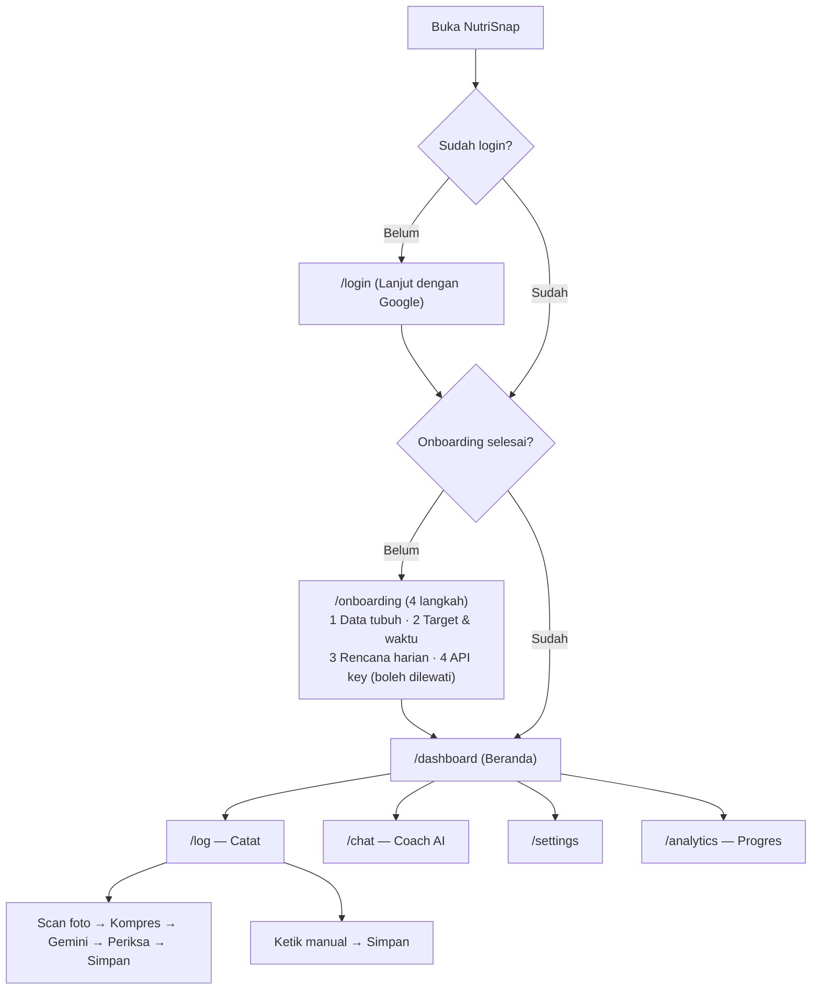

# UI/UX & Design System Specification (DESIGN.md) — NutriSnap

| Versi | Tanggal | Perubahan |
| :--- | :--- | :--- |
| 1.1.0 | 2026-11-06 | Arah visual "Dapur Segar" menggantikan palet slate + 7 warna; token warna baru lulus WCAG AA; aturan suara & bahasa; aturan anti-dummy; komponen status berikon; perbaikan safe-area. Implementasi: `docs/REFACTOR.md`. |
| 1.0.0 | — | Versi awal. |

> **Design Philosophy:** *"Zero-Friction Nutritional Clarity"* — bersih, hangat, dan jelas. Pengguna paham sisa kalori, protein, dan status hari ini dalam kurang dari 1,5 detik, dengan input satu tangan.

---

## 1. Brand Identity & Design Principles

- **Nama Brand:** **NutriSnap**
- **Tagline:** *Foto piringmu, capai targetmu.*
- **Karakter Visual:** hangat, tenang, presisi, tanpa friksi. Bukan "fintech gelap", bukan "gym neon".
- **Logomark:** piring/lingkaran dengan sudut bidik kamera, satu warna `primary`. **Bukan** ikon api (`Flame`).
- **Prinsip Utama:**
  1. **Thumb-First Ergonomics:** aksi primer di layar `< 768px` berada dalam jangkauan ibu jari; area sentuh minimal `44×44px` (termasuk tombol `sm`, navigasi tanggal, chip).
  2. **Glanceable Data Hierarchy:** sisa kalori, progres protein, dan status surplus/defisit terbaca `< 1,5 detik`.
  3. **Tabular Numeric Stability:** semua angka memakai `tabular-nums`.
  4. **Dual-Theme Parity:** Light dan Dark dirancang bersamaan; default mengikuti sistem (`defaultTheme="system"`).
  5. **Honest Data (baru):** UI tidak pernah menampilkan angka contoh sebagai data pengguna. Memuat = skeleton, gagal = pesan + "Coba lagi", kosong = *empty state*. Data contoh hanya di landing page dengan label "Contoh tampilan".
  6. **Plain Language (baru):** teks untuk pengguna awam. Jargon teknis hanya di blok "Detail teknis" yang dilipat.
- **Anti-pola (dilarang):** blob blur/glow latar, gradient teks, bayangan berwarna, chip versi palsu ("2.0"), kartu bersarang lebih dari 1 tingkat, 3–4 kartu identik berikon-di-kotak-berwarna, panel UI palsu (mis. "vault" dekoratif), klaim berlebihan ("standar militer", "akurat").

---

## 2. Design System Foundations (Design Tokens)

### 2.1. Warna — HSL tanpa `hsl()` (kompatibel Tailwind/Shadcn), di `globals.css`

#### A. Surface, Text, & Brand
| Token | Light | Dark | Fungsi |
| :--- | :--- | :--- | :--- |
| `--background` | `40 33% 97%` (krem) | `150 14% 8%` | Kanvas aplikasi |
| `--foreground` | `150 25% 12%` | `40 20% 94%` | Teks utama |
| `--card` / `--popover` | `40 40% 99%` | `150 12% 11%` / `150 12% 13%` | Permukaan kartu, sheet |
| `--primary` | `152 55% 26%` (hijau daun tua) | `148 50% 58%` | Tombol utama, ring kalori, tautan aktif |
| `--primary-foreground` | `40 33% 97%` | `150 40% 8%` | Teks di atas `primary` |
| `--secondary` / `--muted` | `40 20% 93%` | `150 10% 16%` | Chip, track bar, skeleton |
| `--muted-foreground` | `150 8% 38%` | `150 8% 65%` | Label sekunder, satuan |
| `--accent` | `150 30% 92%` | `150 25% 18%` | Hover, item terpilih |
| `--destructive` | `8 65% 45%` | `8 75% 62%` | Hapus, galat |
| `--border` / `--input` | `40 15% 86%` / `40 15% 80%` | `150 10% 20%` / `150 10% 26%` | Garis kartu, outline input |
| `--ring` | `152 55% 26%` | `148 50% 58%` | Fokus keyboard |

#### B. Makro & Status (semantik)
| Token | Light | Dark | Pakai untuk |
| :--- | :--- | :--- | :--- |
| Kalori | = `--primary` | = `--primary` | Ring kalori |
| `--macro-protein` | `222 60% 48%` | `222 85% 76%` | Bar/teks Protein (metrik utama) |
| `--macro-carbs` | `36 90% 30%` | `40 90% 62%` | Karbohidrat |
| `--macro-fat` | `10 65% 42%` | `10 80% 66%` | Lemak |
| `--status-ontrack` | `152 55% 26%` | `148 50% 58%` | Sesuai target |
| `--status-under` | `36 90% 30%` | `40 90% 62%` | Belum mencapai / perlu perhatian |
| `--status-over` | `8 65% 45%` | `8 75% 62%` | Melebihi batas |

- Token di Tailwind: `text-macro-protein`, `bg-macro-carbs/10`, `text-status-over`, dst. (dipetakan di `tailwind.config.ts`).
- **Dihapus:** `--status-surplus` (cyan), `--status-deficit` (ungu), `--status-maintain` (biru). Jenis program (Bulking / Cutting / Maintenance) ditampilkan oleh `GoalChip` netral berikon, bukan warna.
- **Dilarang** memakai kelas warna bawaan Tailwind (`emerald|indigo|amber|rose|cyan|violet|blue|slate|sky|teal`) di `src/`.
- **Kontras:** teks ≥ 4,5 : 1, grafis ≥ 3 : 1 di kedua tema; diverifikasi `pnpm check:contrast`. Nilai di tabel adalah titik awal; sesuaikan bila skrip gagal.

### 2.2. Tipografi

- **Sans (`--font-sans`):** `Plus Jakarta Sans` — UI, angka (selalu `tabular-nums`).
- **Display (`--font-display`):** `Fraunces` — hanya judul besar landing dan, bila cocok, angka hero. Maksimal 2 keluarga font. `JetBrains Mono` **dihapus** (tidak pernah dimuat).
- **Minimum 12 px.** Tidak ada `text-[10px]` / `text-[11px]`.

| Level | Ukuran | Weight | Tailwind | Pakai |
| :--- | :--- | :--- | :--- | :--- |
| Display Metric | 36 px | 800 | `text-4xl font-extrabold tabular-nums tracking-tight` | Sisa kcal di ring |
| Display Landing | 40–60 px | 600 | `font-display text-4xl md:text-6xl tracking-tight` | H1 landing |
| H1 | 24 px | 700 | `text-2xl font-bold tracking-tight` | Judul halaman |
| H2 | 18 px | 600 | `text-lg font-semibold` | Judul seksi |
| H3 | 16 px | 600 | `text-base font-semibold` | Nama makanan |
| Body | 14 px (16 px untuk chat/input mobile) | 400 | `text-sm` | Teks umum |
| Body Medium | 14 px | 500 | `text-sm font-medium` | Label, tombol |
| Caption | 12 px | 500 | `text-xs text-muted-foreground` | Satuan, timestamp, label nav |

### 2.3. Spacing, Radius, Elevasi

- Grid dasar `4px`. Halaman mobile: `px-4 py-4 pb-[calc(5rem+env(safe-area-inset-bottom))]`. Desktop: `px-8 py-6`. Jarak antar kartu `gap-4` / `md:gap-6`.
- **Radius (`--radius: 0.75rem`):** Card `rounded-xl` (12 px), Button/Input `rounded-lg` (10 px), Badge/chip `rounded-full`. Tidak ada `rounded-2xl/3xl` untuk kartu.
- **Elevasi:** kartu datar — `border border-border`, tanpa bayangan (boleh `shadow-sm` netral). **Tanpa** bayangan berwarna/glow. Header sticky & bottom nav: `bg-background/85 backdrop-blur`.
- **Hirarki:** dibangun dari ukuran, bobot, dan spasi; di dalam kartu gunakan garis pemisah tipis, bukan kotak abu-abu bersarang.

### 2.4. Motion

- Ring/bar: `transition-all duration-500 ease-out`. Tombol: `active:scale-[0.98]`. Garis pindai AI di atas foto saat memproses.
- **Wajib** menghormati `prefers-reduced-motion` (nonaktifkan animasi dan `scroll-behavior: smooth`).

---

## 3. Component Design System Library (`apps/frontend/src/components`)

### 3.1. Base Primitives (`components/ui/`)

| Komponen | Varian | Aturan |
| :--- | :--- | :--- |
| `Button` | `default`, `secondary`, `outline`, `ghost`, `destructive` | Tinggi min 44 px di mobile (`sm` = `h-10`); prop `isLoading` (spinner); tanpa bayangan berwarna |
| `Field` + `Label` | — | Membungkus input: `id`/`htmlFor` otomatis, `hint`, `error`, `aria-describedby`, `aria-invalid` |
| `Input` / `Textarea` | `default`, `suffix` (kg, cm, g, kcal) | `h-11`, `text-base md:text-sm` (cegah auto-zoom iOS), `inputMode="decimal"` untuk angka |
| `Card` | `default` | `rounded-xl border`, satu tingkat; `p-4 md:p-6` |
| `Badge` | `default`, `outline`, `secondary`, `success`, `warning`, `danger` | Semua dari token; tidak ada varian berwarna-hue |
| `StatusPill` | `ontrack`, `under`, `over` | **Selalu** ikon + teks (`TrendingUp`, `Minus`, `AlertTriangle`) |
| `GoalChip` | `bulking`, `cutting`, `maintenance` | Chip netral berikon: "Bulking · +385 kcal/hari" |
| `MacroBar` | `protein`, `carbs`, `fat` | `role="progressbar"` + `aria-valuenow/min/max`; label & nilai/target |
| `Progress` | — | ARIA progressbar |
| `Tabs` (segmented) | — | Scan foto \| Ketik manual; `grid-cols-2`, label pendek |
| `Skeleton` | — | Pengganti angka saat memuat |
| `EmptyState` | — | Ikon + 1 kalimat + 1–2 CTA |
| `Dialog` / `Sheet` | — | Dialog di `≥768px`, bottom sheet di `<768px`; untuk konfirmasi hapus |
| `Switch` | — | Pengingat; area sentuh 44 px |
| `Toast` (`sonner`) | `success`, `error`, `undo` | `aria-live="polite"`; hapus = toast **Urungkan** |

### 3.2. Domain Components (`components/nutrition/`, `components/charts/`, `components/landing/`)

1. **`CalorieMacroHeroCard`** — `CalorieRing` (angka besar = **sisa kcal**, kecil = "dari {target} kcal"; penanda garis TDEE; berubah ke `status-over` saat melebihi pada cutting; `role="img"` + `aria-label`), `StatusPill` berisi kalimat status, tiga `MacroBar` (Protein dominan). Tanpa panel statistik abu-abu bersarang.
2. **`MealTimeline`** — satu kartu, empat baris (Sarapan, Makan Siang, Makan Malam, Camilan): kcal • g protein • tombol `+`. Baris terisi dapat dibuka; baris kosong = satu baris "Belum dicatat". Waktu makan yang sedang berlangsung disorot.
3. **`AiFoodScannerCard`** — Idle (tombol **Ambil foto** dan **Pilih dari galeri** + catatan opsional) → Memproses (thumbnail + garis pindai + teks bertahap + **Batal**) → Hasil (label "Estimasi AI — periksa sebelum menyimpan"; nama, berat, kalori bisa diedit; **+ Tambah item**; ringkasan total; **Simpan ke catatan**). Nilai disimpan per gram agar penskalaan tidak menumpuk galat.
4. **`ManualFoodLoggerForm`** — chip makanan populer + "Terakhir dimakan"; nama + gram; makro dihitung per-100 g lalu diskalakan di klien saat gram berubah; kalori/protein dapat dikoreksi; "Detail makro" (karbo, lemak) dilipat. Awal kosong.
5. **`WeightTrendChart`**, **`WeeklyAdherenceChart`** — SVG ringan; 7 kolom selalu lengkap; garis target; nilai terbaca lewat `title`/fokus.
6. **`InstallBanner`**, **`ApiKeyBanner`** — banner kontekstual (lihat §5.3 dan PRD US-02/US-09).
7. **Landing (`components/landing/*`)** — Hero (dengan mockup nyata berlabel "Contoh tampilan dengan data fiktif"), CaraKerja (3 langkah tanpa kartu), Kalkulator, Fitur (bento berisi cuplikan UI), PenjelasanApiKey, FAQ, Footer.

---

## 4. Responsive Layout Architecture

### 4.1. Mobile & PWA (`< 768px`)

```text
+---------------------------------------+
| [Logo] Judul Halaman    [●key] [Tema] |  <- Sticky top header (h-14)
+---------------------------------------+
|  Halo, Raka          Jum, 6 Nov 2026  |
|  [Bulking · +385 kcal/hari]           |
|  +-------------------------------+    |
|  |  (ring)   Masih 620 kcal      |    |  <- Hero card: ring + StatusPill
|  |  1.850    menuju target       |    |     + Protein/Karbo/Lemak
|  |  Protein ▓▓▓▓▓▓░░ 118/140 g   |    |
|  +-------------------------------+    |
|  Sarapan   520 kcal • 28 g P     [+]  |  <- MealTimeline (1 kartu, 4 baris)
|  Makan Siang  Belum dicatat      [+]  |
+---------------------------------------+
| Beranda Progres ((Catat)) Coach Setelan|  <- Fixed bottom nav
+---------------------------------------+
```

**Bottom Navbar:** `fixed bottom-0 inset-x-0 z-50 md:hidden`; tinggi `h-[calc(4rem+env(safe-area-inset-bottom))]` dengan `pb-[env(safe-area-inset-bottom)]` (inset **menambah** tinggi, bukan memakan); `bg-background/85 backdrop-blur border-t`; label `text-xs`; `aria-current="page"`.

| # | Rute | Label | Ikon |
|---|------|-------|------|
| 1 | `/dashboard` | Beranda | `LayoutDashboard` |
| 2 | `/analytics` | Progres | `TrendingUp` |
| 3 | `/log` | Catat (tombol tengah menonjol, ikut status aktif) | `Camera` |
| 4 | `/chat` | Coach | `BotMessageSquare` |
| 5 | `/settings` | Pengaturan | `Settings` |

### 4.2. Tablet & Desktop (`>= 768px`)

Sidebar kiri `w-64`: Beranda, Catat Makanan, Coach AI, Progres, Pengaturan. Di bawah: **status API key nyata** ("API key aktif · AIza…7f9Q" atau "Belum diatur → Atur") dan blok profil (nama, email, Keluar). Konten memakai bento 12 kolom, `max-w-5xl`.

---

## 5. User Flows & Key Screens



- **Guard rute:** semua rute selain `/`, `/login`, `/privacy`, `/terms` dilindungi `AuthGate`; tanpa sesi → `/login?next=…`; tanpa profil → `/onboarding`.

### 5.1. Onboarding (`/onboarding`)
1. **Data tubuh:** nama (dari akun Google), gender, usia, tinggi, berat, aktivitas (5 opsi ber-contoh). **Semua kosong di awal**, contoh hanya sebagai placeholder. Validasi inline.
2. **Target & waktu:** target berat, durasi (bulan/tahun, tidak mereset nilai), ringkasan selisih berat dan perubahan per minggu.
3. **Rencana harian:** BMI (+ catatan bukan diagnosis), kalori maintenance, target kalori + delta/hari, protein, karbo, lemak. Guardrail → banner dengan **Sesuaikan ke rentang aman** / **Ubah target**.
4. **API key:** input bermasker, panduan 3 langkah, **Simpan & uji key**, dan **Lewati dulu** (dengan penjelasan konsekuensinya). Mode edit (dari Pengaturan) memuat profil lama.
- Mobile: tombol aksi menempel di bar bawah.

### 5.2. Coach AI (`/chat`)
- Layar penuh: pesan menggulir, composer menempel di atas bottom nav. Header konteks satu baris (`GoalChip` + "Sisa hari ini: … kcal · … g protein"; skeleton saat memuat, disembunyikan bila gagal).
- Quick prompt dinamis dari sisa target; `?prompt=` mengisi composer tanpa mengirim.
- Balasan dirender Markdown (tabel, daftar) tanpa HTML mentah. Pesan optimistis; gagal → "Gagal terkirim · Coba lagi". Tanpa API key → composer nonaktif + kartu ajakan.
- Catatan kaki: *Saran umum, bukan pengganti konsultasi dokter atau ahli gizi.*

### 5.3. PWA & Notifikasi
- **Install Banner:** muncul di browser non-standalone; Android memakai `beforeinstallprompt`, iOS menampilkan instruksi "Bagikan → Tambahkan ke Layar Utama". Dismiss tersimpan.
- **Pengingat makan (`/settings#reminder`):** Switch utama, zona waktu, jam Sarapan/Siang/Malam. Izin ditolak atau push tidak didukung → keadaan jelas, **tidak** ada langganan palsu. Tombol uji hanya aktif bila langganan nyata ada. Catatan iOS: pasang dulu ke Layar Utama.
- `sw.js` didaftarkan sekali oleh `PwaManager` global. Manifest: `start_url: "/dashboard"`, ikon `any` + `maskable`, `shortcuts` ke `/log`.

---

## 6. Accessibility (a11y)

1. **Kontras WCAG 2.1 AA** terverifikasi skrip (`pnpm check:contrast`).
2. **Zoom tidak boleh diblokir:** tanpa `maximum-scale` / `user-scalable=no`.
3. **iOS auto-zoom:** semua `input/select/textarea` `≥16px` di mobile (`text-base md:text-sm`).
4. **Tidak hanya warna:** surplus/defisit/melebihi selalu disertai ikon semantik dan teks eksplisit.
5. **Label & ARIA:** setiap input punya label terhubung; `Progress`/`MacroBar` berperan `progressbar`; `CalorieRing` berperan `img` dengan `aria-label`; tombol ikon punya `aria-label`; status dinamis memakai `aria-live="polite"`.
6. **Touch target ≥ 44×44 px**; fokus keyboard terlihat; `prefers-reduced-motion` dihormati.

---

## 7. Content & Voice Guidelines (baru)

- **Bahasa:** Indonesia; sapaan **"kamu"**. Kata serapan lazim dipertahankan (*Bulking, Cutting, Maintenance, Protein, Kalori, Makro, Scan, API key*).
- **Satuan baku:** `kcal`, `g`, `kg`, `cm`. Angka: pemisah ribuan titik, desimal koma di tampilan (`2.415 kcal`, `58,5 kg`) lewat `lib/format.ts`; tanggal lewat `lib/date.ts` (zona waktu profil).
- **Nada:** pendek, konkret, kata kerja di depan; tidak ada superlatif tak terbukti. Hasil AI selalu disebut **estimasi** dan dapat dikoreksi.
- **Jargon teknis** (AES-256-GCM, IV/Auth Tag, nama model, nama paket internal) hanya di `<details>` "Detail teknis" atau `docs/`.
- **Glosarium baku:** Beranda · Catat · Coach AI · Progres · Pengaturan · Kalori maintenance · Kalori istirahat (BMR) · Surplus/Defisit · Melebihi target · Rencana harian · API key Gemini · Scan foto makanan · Ketik manual. (Daftar lengkap: `docs/REFACTOR.md` §2.4.)
- **Disclaimer kesehatan:** landing footer, hasil BMI/rencana, dan Coach AI memuat catatan bahwa NutriSnap bukan alat medis.
- **Dilarang:** klaim kinerja/akurasi/keamanan yang tidak dapat dibuktikan; angka kuota Google yang dijanjikan; fitur yang belum ada (mis. "hapus akun") disebut di UI.
