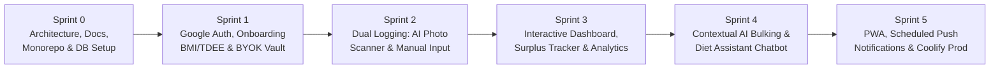

# Agile Sprint Plan & Product Roadmap (SPRINT.md) — NutriSnap

> **Metodologi:** Agile Scrum (Iterative Delivery)  
> **Skala Estimasi:** Fibonacci Story Points (`1`, `2`, `3`, `5`, `8`)  
> **Target Deployment:** Self-Hosted Monorepo on Coolify

---

## 1. Ringkasan Peta Jalan (*Sprint Roadmap*)

| Sprint | Tema Utama | Total Story Points | Target Deliverable Utama |
| :--- | :--- | :---: | :--- |
| **Sprint 0** | Foundation, Agile Docs, Monorepo & Database | **16 SP** | Dokumentasi `/docs` + `AGENTS.md`, Workspace `apps/frontend`, `apps/backend`, `packages/shared`, Skema DB Drizzle. |
| **Sprint 1** | Auth, Personalization Onboarding & BYOK Vault | **21 SP** | Login Google OAuth, Wizard Onboarding (Kalkulator BMI/BMR/TDEE/Surplus), Enkripsi `AES-256-GCM` Gemini Key. |
| **Sprint 2** | Dual Nutrition Logging (AI Vision + Manual Gram) | **24 SP** | Kompresi Foto Client, Gemini Multimodal Food Scanner, Form Input Manual (Nama + Gram), Database Makanan Lokal. |
| **Sprint 3** | Interactive Dashboard, Responsive Nav & Analytics | **18 SP** | Bottom Navbar (`<768px`), Light/Dark Mode, Calorie/Protein Ring, Surplus/Deficit Badge, Grafik Berat Badan & Kalori. |
| **Sprint 4** | AI Bulking & Diet Assistant Chatbot | **13 SP** | Chatbot khusus bulking/diet dengan injeksi konteks profil & progres kalori/protein harian pengguna. |
| **Sprint 5** | PWA, Scheduled Meal Push Notifications & Coolify | **16 SP** | Manifest PWA, Service Worker (`sw.js`), Cron Pengingat Makan Harian via VAPID Web Push, Dockerfile & Compose Coolify. |

---

## 2. Rincian Backlog per Sprint

### Sprint 0: Foundation, Agile Documentation & Monorepo Core
**Sprint Goal:** Membangun fondasi arsitektur monorepo yang bersih, paket bersama (`@nutrisnap/shared`) berisi rumus nutrisi teruji, dan skema database PostgreSQL.

| ID Task | User Story / Engineering Task | Komponen | Story Points |
| :--- | :--- | :--- | :---: |
| `NS-001` | Penyusunan `AGENTS.md`, `PRD.md`, `DESIGN.md`, `ARCHITECTURE.md`, `API_CONTRACT.md`, `SPRINT.md`, dan `PROGRESS_TRACKER.md` | `docs/` | 3 |
| `NS-002` | Inisialisasi Monorepo (`pnpm-workspace.yaml`, root `package.json`, `tsconfig.base.json`) | `root` | 2 |
| `NS-003` | Pembuatan `packages/shared`: Rumus BMI, BMR (Mifflin-St Jeor), TDEE, Surplus/Deficit Calculator, & Zod Schemas + Unit Tests | `packages/shared` | 5 |
| `NS-004` | Setup `apps/backend` (TypeScript server, CORS, Env Validator, Drizzle ORM + Skema PostgreSQL Lengkap + Seed Makanan Lokal) | `apps/backend` | 3 |
| `NS-005` | Setup `apps/frontend` (Next.js App Router, Tailwind CSS, Shadcn UI, ThemeProvider Light/Dark) | `apps/frontend` | 3 |

---

### Sprint 1: Authentication, Onboarding Engine & BYOK Security Vault
**Sprint Goal:** Pengguna dapat login via Google OAuth, menyelesaikan kuesioner personalisasi fisik & target berat badan, serta menyimpan Gemini API Key pribadi dengan enkripsi `AES-256-GCM`.

| ID Task | User Story / Engineering Task | Komponen | Story Points |
| :--- | :--- | :--- | :---: |
| `NS-101` | Implementasi Modul Enkripsi `AES-256-GCM` (`encryptApiKey`, `decryptApiKey`) beserta Unit Test keamanan | `apps/backend` | 5 |
| `NS-102` | Implementasi Google OAuth 2.0 Authentication & Session Management (`auth` module + middleware) | `apps/backend` + `apps/frontend` | 5 |
| `NS-103` | Endpoint & UI manajemen BYOK Gemini API Key (`/api/v1/apikey` + live validation ke Google Gemini API) | `apps/backend` + `apps/frontend` | 5 |
| `NS-104` | Endpoint & Multi-step UI Wizard `/onboarding` (Input Nama, Usia, Tinggi, Berat, Gender, Target Berat, Target Bulan/Tahun -> Kalkulasi BMI, TDEE, Kalori & Protein) | `apps/backend` + `apps/frontend` | 6 |

---

### Sprint 2: Dual Nutrition Logging (AI Food Photo Scanner & Manual Input)
**Sprint Goal:** Pengguna dapat mencatat asupan makanan baik melalui foto kamera/galeri yang dianalisis oleh Gemini Multimodal maupun melalui input manual (nama makanan + berat gram).

| ID Task | User Story / Engineering Task | Komponen | Story Points |
| :--- | :--- | :--- | :---: |
| `NS-201` | Utilitas kompresi gambar di browser (`<= 1280px`, WebP/JPEG) untuk mempercepat upload dari kamera HP | `apps/frontend` | 3 |
| `NS-202` | Service Gemini Multimodal Food Vision (`POST /api/v1/meals/scan-photo`) dengan `responseSchema` JSON terstruktur | `apps/backend` | 8 |
| `NS-203` | Service Kalkulator Makro Manual (`POST /api/v1/meals/estimate-manual`) menggunakan DB makanan lokal + fallback Gemini | `apps/backend` | 5 |
| `NS-204` | Endpoint CRUD Meal Logs (`POST /api/v1/meals`, `GET /api/v1/meals/daily`, `DELETE /api/v1/meals/:id`) | `apps/backend` | 3 |
| `NS-205` | Halaman `/log` Dual Logger UI: Tab 1 (AI Camera Scanner + Editable Confirmation Card) & Tab 2 (Manual Input + Berat Gram) | `apps/frontend` | 5 |

---

### Sprint 3: Interactive Dashboard, Responsive Navigation (`<768px`) & Analytics
**Sprint Goal:** Menyajikan pengalaman visual kelas satu dengan navigasi bawah pada layar mobile (`<768px`), ringkasan kalori/protein real-time, status surplus/defisit, dan grafik progres berat badan.

| ID Task | User Story / Engineering Task | Komponen | Story Points |
| :--- | :--- | :--- | :---: |
| `NS-301` | Responsive App Shell: Fixed Bottom Navbar pada `< 768px` (dengan tombol tengah Scan/Log) & Sidebar pada `>= 768px` | `apps/frontend` | 5 |
| `NS-302` | Halaman `/dashboard`: Calorie Ring, Surplus/Deficit Status Tracker, Macro Progress Bars (Protein/Carbs/Fat), & Daily Meal Timeline | `apps/frontend` | 8 |
| `NS-303` | Halaman `/analytics`: Pencatatan berat badan berkala (`weight_logs`), BMI Tracker, & grafik kepatuhan kalori mingguan | `apps/backend` + `apps/frontend` | 5 |

---

### Sprint 4: Contextual AI Bulking & Diet Assistant Chatbot
**Sprint Goal:** Menyediakan asisten chatbot cerdas yang memahami profil tubuh pengguna dan progres makan hari ini untuk menjawab pertanyaan seputar bulking dan diet.

| ID Task | User Story / Engineering Task | Komponen | Story Points |
| :--- | :--- | :--- | :---: |
| `NS-401` | Backend AI Diet Coach (`POST /api/v1/chat/message` & `GET /api/v1/chat/history`) dengan injeksi dinamis profil BMR/TDEE & sisa kalori/protein hari ini | `apps/backend` | 5 |
| `NS-402` | Halaman `/chat`: Antarmuka Chatbot modern dengan *Quick Prompt Chips*, dukungan Markdown, dan indikator *status konteks nutrisi* | `apps/frontend` | 5 |
| `NS-403` | Penanganan *graceful fallback* & pesan panduan ramah jika BYOK API Key pengguna belum diatur atau mencapai kuota limit | `apps/frontend` + `apps/backend` | 3 |

---

### Sprint 5: PWA, Scheduled Push Notifications & Coolify Production Readiness
**Sprint Goal:** Mengoptimalkan aplikasi sebagai PWA penuh untuk iOS/Android, mengaktifkan pengingat makan terjadwal via Web Push, dan menyiapkan konfigurasi deployment Coolify.

| ID Task | User Story / Engineering Task | Komponen | Story Points |
| :--- | :--- | :--- | :---: |
| `NS-501` | Konfigurasi PWA (`manifest.ts`, ikon multi-ukuran, Apple PWA meta tags, Service Worker `public/sw.js`, & Install Banner) | `apps/frontend` | 5 |
| `NS-502` | Modul Web Push VAPID (`/api/v1/notifications/*`) & Cron Scheduler (`meal-reminder.job.ts`) untuk mengecek makan harian yang belum di-log | `apps/backend` | 5 |
| `NS-503` | Halaman `/settings` lengkap: Manajemen BYOK API Key, Edit Target Berat/Kalori, Pengaturan Jam Push Notification, & Toggle Light/Dark Mode | `apps/frontend` | 3 |
| `NS-504` | Pembuatan `Dockerfile` (`apps/frontend` & `apps/backend`), `docker-compose.coolify.yml`, `.env.example`, dan pengujian build End-to-End | `root` | 3 |

---

## 3. Definition of Done (DoD)

Sebuah User Story atau Task hanya boleh dipindahkan ke status **`DONE`** di [`docs/PROGRESS_TRACKER.md`](file:///d:/CODING/PROJECT/nutrisnap/docs/PROGRESS_TRACKER.md) apabila memenuhi seluruh kriteria berikut:
1. **Type-Safe & Lint Clean:** Kode lulus `pnpm typecheck` tanpa error TypeScript.
2. **Contract Compliant:** Input dan output API tervalidasi menggunakan skema Zod dari `@nutrisnap/shared`.
3. **Security Verified:** Tidak ada rahasia/API key yang bocor ke log atau response client.
4. **Responsive & Theme-Ready:** Tampilan berfungsi sempurna di viewport mobile (`375px` dengan Bottom Navbar) maupun desktop (`1280px+` dengan Sidebar), baik pada mode Terang (*Light*) maupun Gelap (*Dark*).
5. **Tracker Updated:** Status task pada `docs/PROGRESS_TRACKER.md` telah diperbarui.

